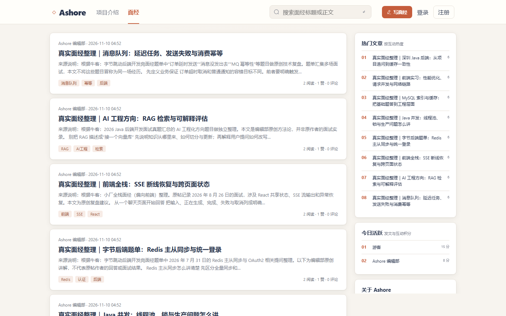

# Ashore · 上岸

面经分享与 AI 辅助复盘社区。读面经、记录真实经历，并围绕文章内容追问技术细节。

[在线演示](https://111.228.13.15:8443/) · [功能截图](#界面预览) · [本地运行](#本地运行)

> 演示站点当前使用 IP 证书和 8443 端口。演示环境的游客入口使用共享账号，请勿填写私人信息。

## 界面预览



## 已实现功能

- 面经：发布与编辑 Markdown 图文文章、标签、搜索、文章详情和目录；支持点赞、收藏、评论及举报。
- 社区：用户主页、通知、热门文章与今日活跃榜。搜索优先使用 Elasticsearch，故障时降级到数据库检索。
- AI 复盘：基于文章内容提问，以及模拟面试与历史记录；需要配置 AI 服务商密钥。
- 账号：注册登录、持久化游客账号、个人资料与管理员内容管理。游客入口由所有访问者共用，消息、收藏和互动记录也共用。
- 工程：MySQL + Flyway 迁移、Redis 会话、MinIO 图片存储；前后端同源部署。

## 技术与结构

| 部分 | 实现 |
| --- | --- |
| 前端 | Vue 3、TypeScript、Vite 6、Element Plus、Vue Router |
| 后端 | Java 21、Spring Boot 3.5.6、Spring MVC、MyBatis-Plus 3.5.18 |
| 数据 | MySQL 8、Flyway、Redis、Elasticsearch、MinIO |
| 构建与部署 | Maven 多模块、pnpm、Nginx |

后端模块按依赖方向排列：`ashore-api` → `ashore-core` → `ashore-service` → `ashore-web`。前端位于 `frontend/`，通过 `/api` 请求后端。

## 本地运行

需要 JDK 21、Node.js 24、pnpm 12，以及可访问的 MySQL 8 和 Redis。`deploy/dev-server/compose.yaml` 提供本地 MySQL、Redis 示例；Elasticsearch 不可用时搜索会降级，AI 功能需要额外的 API 密钥，图片上传需要 MinIO。

1. 准备数据库和环境变量。可将 [`deploy/dev-server/.env.example`](deploy/dev-server/.env.example) 复制为同目录的 `.env`，更换示例密码后启动容器：

   ```sh
   docker compose --env-file deploy/dev-server/.env -f deploy/dev-server/compose.yaml up -d
   ```

   再在仓库根目录创建未追踪的 `.env`，写入相同的 `ASHORE_DB_NAME`、`ASHORE_DB_USERNAME`、`ASHORE_DB_PASSWORD`，并设置 `ASHORE_DB_PORT=3306`、`ASHORE_REDIS_PORT=6379`。默认开发端口面向 SSH 隧道，本地容器需显式指定这两个端口。
2. 启动后端：

   ```sh
   # 先确保 JAVA_HOME 指向 JDK 21
   ./mvnw -pl ashore-web -am package -DskipTests
   java -jar ashore-web/target/ashore-web-0.0.1-SNAPSHOT.jar --spring.profiles.active=dev
   ```

3. 另开终端启动前端：

   ```sh
   cd frontend
   corepack enable
   pnpm install --frozen-lockfile
   pnpm dev
   ```

前端默认运行在 `http://127.0.0.1:5173`，Vite 将 `/api` 代理到后端 `127.0.0.1:8080`。后端健康检查为 `http://127.0.0.1:8080/actuator/health`。

```sh
./mvnw test
cd frontend && pnpm typecheck && pnpm build
```

## 说明

项目参考并重新实现了 [技术派（paicoding）](https://github.com/itwanger/paicoding) 的社区架构，围绕面经与复盘重新设计了产品流程和界面。原项目采用 Apache-2.0 许可证；本仓库的许可见 [LICENSE](LICENSE)。
